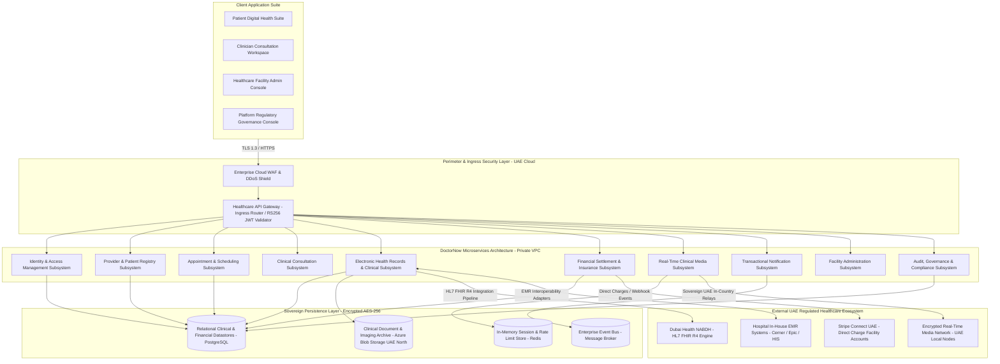
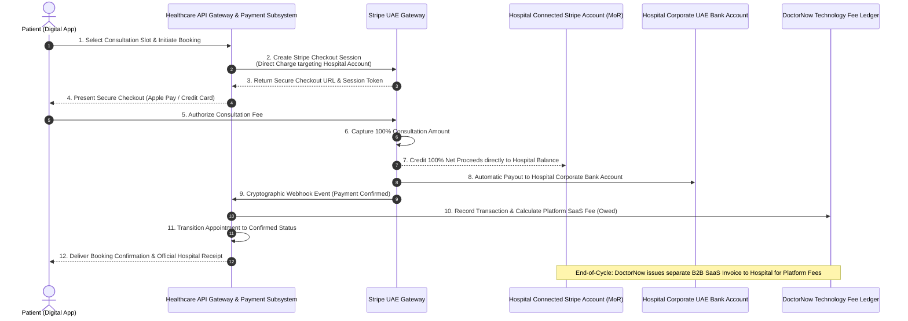

# DoctorNow Healthcare Platform: Enterprise Architecture Specification
## Official Technical & Regulatory Submission for Dubai Health (DHA) Compliance Review

**Document Reference:** DN-DHA-ARCH-2026-OFFICIAL  
**Submitting Entity:** DoctrNow Healthcare LLC-FZ  
**Regulatory Authority:** Dubai Health Authority (DHA), Government of Dubai, United Arab Emirates  
**Classification:** Official Regulatory Submission — Technical Architecture & Interoperability Blueprint  
**Date of Submission:** October 2026  
**Applicable Legal & Regulatory Standards:**
- UAE Federal Law No. 2 of 2019 Concerning the Use of Information and Communication Technology in Health Fields (UAE Health Data Law)
- UAE Federal Decree-Law No. 45 of 2021 on Personal Data Protection (UAE PDPL)
- Dubai Health Authority (DHA) Telehealth Regulations & Health Informatics Guidelines
- Dubai Health Information Exchange (NABDH) HL7 FHIR R4 Interoperability Specifications
- UAE Central Bank Retail Payment Services & Stored Value Facility (SVF) Regulatory Framework

---

## Executive Summary

**DoctorNow** is an enterprise multi-tenant digital health, teleconsultation, and clinical workflow platform engineered to operate within the healthcare regulatory framework of the United Arab Emirates. The platform connects patients across the UAE with DHA-licensed healthcare facilities (hospitals and medical centers) and DHA-credentialed clinicians for scheduled and urgent teleconsultations, electronic prescriptions (e-Rx), and encrypted health record exchange.

This document serves as the **official technical architecture specification** submitted to **Dubai Health (DHA)**. It outlines the platform’s core design principles, specifically addressing:
1. **UAE Sovereign Data Residency**: Strict in-country cloud deployment with zero cross-border Protected Health Information (PHI) transmission and sovereign media routing.
2. **Healthcare Regulatory Compliant Payment Architecture**: A Stripe Connect Direct Charge model operating participating hospitals as the legal **Merchant of Record (MoR)**, ensuring 100% of patient consultation payments settle directly to licensed facilities, fully complying with UAE medical liability and anti-fee-splitting regulations.
3. **NABDH & Hospital EMR Interoperability**: A native **HL7 FHIR Release 4 (R4)** integration engine designed to interface seamlessly with the Dubai Health NABDH Health Information Exchange (HIE) and in-house hospital Electronic Medical Record (EMR) systems (including Oracle Cerner Millennium and Epic).
4. **Information Security & Clinical Governance**: Tamper-evident clinical audit logging, role-based access controls, and end-to-end cryptographic safeguards adhering to DHA Health Informatics standards.

---

## 1. Enterprise System Architecture & Infrastructure

### 1.1 Multi-Tenant Client Application Suite
The DoctorNow platform provides dedicated, role-specific client interfaces designed for secure clinical interactions:
- **Patient Digital Health Portal & Mobile App**: Enables patients to discover DHA-licensed doctors and healthcare facilities, schedule appointments, attend secure high-definition virtual consultations, securely access electronic prescriptions, and complete payments.
- **Clinician Consultation Workspace**: Provides licensed healthcare professionals with real-time consultation queue management, virtual waiting room controls, integrated clinical documentation (ICD-10-AM / SNOMED CT diagnostic coding), electronic prescription formulation, and patient health history review.
- **Healthcare Facility Administration Console**: Enables hospital and clinic administrators to manage facility departments, physician credentialing, clinical rosters, appointment capacities, and institutional settlement reporting.
- **Platform Regulatory & Governance Console**: Enables platform operators and compliance auditors to verify DHA institutional and professional licenses, manage provider onboarding approvals, configure platform parameters, and inspect immutable audit logs.

### 1.2 System Topology & Ingress Security Architecture
All external traffic is secured through a multi-tier perimeter defense and routed via an enterprise **Healthcare API Gateway** that enforces TLS 1.3, rate limiting, and cryptographic token verification:

### 1.3 UAE Sovereign Cloud Data Residency
In strict adherence to **UAE Federal Law No. 2 of 2019 (Article 13)**, DoctorNow guarantees that all Protected Health Information (PHI) and medical transaction records remain strictly localized within the sovereign territory of the United Arab Emirates:
- **In-Country Hosting**: Production workloads and databases are hosted exclusively within the **Microsoft Azure UAE North** region in Dubai.
- **Data Isolation**: All clinical databases, diagnostic reports, and patient files are maintained in private subnets with strict egress filtering, preventing any data replication or routing outside the UAE.
- **Sovereign Real-Time Video Streaming**: Teleconsultation video and audio streams are processed exclusively through **UAE-localized real-time media relay nodes**, ensuring that clinical communications do not leave UAE telecommunication backbones.
- **Cryptographic Protection**:
  - **Data at Rest**: AES-256 encryption applied across all databases, backups, and file storage volumes.
  - **Data in Transit**: Mandatory TLS 1.3 encryption across all communication paths with Perfect Forward Secrecy (PFS).

---

## 2. Healthcare Payment Architecture (Stripe Connect Direct Charges)

### 2.1 Regulatory Mandate: Healthcare Facility as Merchant of Record
Under UAE healthcare and financial regulations:
1. **Medical Liability & Fee Splitting**: Non-clinical technology platforms are legally prohibited from practicing medicine, acting as commercial healthcare brokers, or pooling clinical consultation fees. Retaining patient clinical payments within a platform treasury can be construed as unauthorized healthcare intermediation or illegal medical fee-splitting.
2. **Central Bank Regulatory Compliance**: Collecting patient consultation fees into a centralized platform account for later disbursement exposes the technology provider to UAE Central Bank Stored Value Facility (SVF) or Payment Service Provider (PSP) licensing obligations.

To eliminate regulatory exposure, DoctorNow employs the **Direct Charge model on Standard Connected Accounts** under Stripe Connect UAE.

### 2.2 Financial Architecture: Direct Charges & Separate B2B Technology Invoicing
Under this officially approved architecture:
- **Account Model**: Participating hospitals and clinics onboard directly with Stripe UAE as **Standard Connected Accounts**, completing identity, trade license, and DHA facility verification.
- **Merchant of Record (MoR)**: The **Licensed Hospital or Clinic** is the sole legal Merchant of Record. The patient’s bank statement displays the hospital's registered commercial name, as configured in the hospital's own Stripe account.
- **100% Direct Settlement to Healthcare Facility**: 100% of the patient’s consultation payment (minus standard card interchange processing fees) flows immediately into the hospital's connected Stripe balance and settles directly into their corporate UAE bank account.
- **Zero In-Flight Fee Splitting**: DoctorNow **does not** automatically deduct platform commissions at checkout (`application_fee_amount = 0`), preventing any commingling of clinical revenue with technology fees.
- **Separate B2B Technology Invoicing**: DoctorNow’s technology platform licensing fee is recorded asynchronously on an internal ledger. At the end of each billing cycle (monthly/bi-weekly), DoctorNow issues a formal commercial B2B SaaS invoice to the healthcare facility for technology services, maintaining a complete legal and financial separation between medical services and technology licensing.

### 2.3 End-to-End Payment & Settlement Workflow

### 2.4 Cancellation, Refund & Dispute Governance
- **Direct Refund Origin**: Customer refunds originate directly from the hospital’s connected balance. Because the healthcare facility is the legal Merchant of Record, customer chargeback and dispute liabilities rest with the facility, insulating the technology platform from clinical financial liabilities.
- **Automated Grace Period Policy**: If a patient cancels with greater than 2 hours' notice, or if a clinician is unavailable during the designated consultation grace window (`PROVIDER_NO_SHOW`), the payment subsystem triggers an automated refund directly to the patient’s card.
- **Dispute Resolution Pipeline**: Dedicated administrative dashboards allow healthcare facilities to upload evidence directly to Stripe UAE for dispute arbitration.

### 2.5 High-Availability Payment Resilience & Multi-Tier Reconciliation
To guarantee zero dropped transactions or orphaned bookings during peak traffic or network degradation, the platform operates a three-tier reconciliation engine, supported by continuous facility account status synchronization:
1. **Cryptographic Webhook Ingestion**: Ingests raw-buffer webhook signatures from Stripe UAE to confirm transactions asynchronously.
2. **Client-Return Instant Verification**: Upon patient return from the payment gateway, the application triggers immediate server-to-server verification against Stripe to confirm settlement without awaiting webhook delivery.
3. **Automated Reconciliation Engine**: An automated background daemon scans any pending transactions older than 2 minutes, verifying their real-time status with Stripe and automatically unlocking abandoned slots or confirming valid appointments.
4. **Facility Account Status Synchronization**: Continuously verifies that participating facilities maintain active charge and payout capabilities before allowing slot bookings.

---

## 3. Planned EHR & HIE Interoperability Architecture (NABDH & Hospital EMRs)

### 3.1 Dubai Health NABDH Integration Standard
Dubai Health mandates integration with the **NABDH** Health Information Exchange for digital telehealth consultations. DoctorNow incorporates an enterprise integration subsystem engineered to the **HL7 FHIR Release 4 (R4)** standard.

The platform architecture also natively supports sandbox interoperability with **Oracle Cerner Millennium FHIR R4**, **Epic Systems**, and national health platforms via standard FHIR and HL7 adapters.

### 3.2 Native Database Synchronization Tracking
Every clinical record stored within DoctorNow incorporates native database-level synchronization attributes to guarantee full traceability with Dubai Health NABDH:

- **Record Unique Identifier**: Universal Unique Identifier (UUIDv4) linked to patient and consultation charts.
- **FHIR Resource Binding**: `fhir_resource_id` and `fhir_resource_type` referencing external HIE identifiers.
- **NABDH Synchronization State**: Immutable boolean indicator (`synced_to_nabdh`) tracking successful transmission and acknowledgment from the Dubai Health NABDH endpoint.
- **National System State**: Secondary synchronization attribute (`synced_to_riayati`) enabling nationwide interoperability with federal UAE health data systems.

### 3.3 Clinical Resource Mapping Specifications

Every clinical data element captured during a DoctorNow teleconsultation is mapped directly into standard HL7 FHIR R4 resources conforming to Dubai Health informatics guidelines:

| DoctorNow Clinical Domain | Target FHIR R4 Resource | Standard Coding / Identifier | NABDH Integration Workflow |
| :--- | :--- | :--- | :--- |
| **Patient Identification** | `Patient` | UAE Emirates ID (`784-XXXX-XXXXXXX-X`), DHA MPI | Primary identity verified through Emirates ID, mapping to Dubai Health Master Patient Index (MPI). |
| **Healthcare Provider** | `Practitioner` / `Organization` | DHA Professional License Number, DHA Facility License Number | Records treating clinician’s DHA license and the licensed hospital/clinic organization. |
| **Teleconsultation Encounter** | `Encounter` | Encounter Class: `VR` (Virtual / Telehealth), SNOMED CT | Captures session timing, duration, virtual modality (audio/video), and facility context. |
| **Clinical Diagnosis** | `Condition` | **ICD-10-AM** / **SNOMED CT** | Mandatory clinical diagnosis codes recorded by the clinician upon consultation completion. |
| **Electronic Prescription** | `MedicationRequest` | UAE Drug Trade Code, RxNorm, ATC Coding | Digital e-Rx containing trade name, active ingredient, dosage, frequency, route, duration, and electronic signature. |
| **Clinical Observations** | `Observation` | LOINC (Logical Observation Identifiers) | Patient vital signs recorded during triage or consultation (blood pressure, heart rate, temperature, SpO2). |
| **Clinical Documentation** | `DocumentReference` | MIME: `application/pdf`, LOINC Document Codes | Stores encrypted storage pointers and cryptographic hashes for signed clinical encounter summaries. |

### 3.4 In-House Hospital EMR Integration Interface
For healthcare facilities operating in-house EMR systems (such as Oracle Cerner Millennium, Epic Systems, or proprietary Hospital Information Systems), DoctorNow provides a standardized integration adapter interface enabling bi-directional data exchange:

- **Schedule Synchronization**: Ingests physician availability, clinic rosters, and operational slots from hospital scheduling engines into DoctorNow.
- **Clinical Encounter Push**: Pushes completed consultation encounter notes, diagnoses, and vitals back into the hospital’s primary EMR upon session completion.
- **Electronic Prescription Routing**: Delivers digital prescriptions into hospital pharmacy management systems for dispensing and insurance adjudication.
- **Patient Verification**: Cross-references patient Emirates ID against hospital master patient indices to prevent chart duplication.

### 3.5 Interoperability API Gateway Endpoints
The platform exposes standardized, authenticated FHIR R4 endpoints for secure clinical data exchange:
- `GET /api/v1/fhir/Patient`: Search and demographic verification by Emirates ID or DHA identifier.
- `GET /api/v1/fhir/patient-summary/{id}`: Consolidated longitudinal health summary (demographics, active conditions, vitals, encounters, and active medications).
- `GET /api/v1/fhir/Observation`: Clinical vitals and laboratory results coded in LOINC.
- `GET /api/v1/fhir/Condition`: Patient problem list and diagnostic records coded in ICD-10-AM / SNOMED CT.
- `GET /api/v1/fhir/Encounter`: Telehealth consultation encounter history.
- `GET /api/v1/fhir/MedicationRequest`: Electronic prescription orders with structured dosage parameters.
- `GET /api/v1/fhir/Practitioner`: Credentialed clinician directory and DHA licensing data.

---

## 4. Information Security, Access Governance & Clinical Audit Trail

### 4.1 Role-Based Access Control (RBAC) & Identity Assurance
- **Access Roles**: Enforces four strict, non-overlapping access tiers:
  - `PATIENT`: Strictly restricted to personal health records, appointment bookings, and assigned consultation sessions.
  - `DOCTOR`: Authorized to access assigned patient medical charts, record diagnoses, and issue digital prescriptions.
  - `HOSPITAL_ADMIN`: Scoped exclusively to institutional clinician rosters, facility appointment queues, and institutional financial settlement reports.
  - `SUPER_ADMIN`: Regulatory oversight, DHA license validation, and system-wide security audit inspection.
- **Stateless Authentication**: Cryptographically signed RS256 JSON Web Tokens (JWT) with 15-minute validity, verifiable via a standardized JSON Web Key Set (JWKS) endpoint. Refresh tokens are secured in encrypted, HttpOnly, SameSite cookies.
- **Identity Verification**: Mandatory UAE Emirates ID validation for patients and clinicians, with a one-time-password (OTP) second factor at sign-in for patients and clinicians; a second factor for hospital administrator and super administrator accounts is planned.

### 4.2 Comprehensive Audit Trail Architecture
The platform operates an append-only, tamper-evident audit repository documenting every interaction with Protected Health Information (PHI):
- **Audit Granularity**: Captures actor identity, user role, specific clinical action (view, modify, export, sign), target entity, before/after record states, IP address, user-agent, and cryptographic timestamps.
- **Automated Compliance Reporting**: Supports automated generation of regulatory compliance audit extracts tailored to DHA and UAE Personal Data Protection Law requirements.
- **Immutable Log Retention**: Audit logs are retained within write-once storage volumes preventing deletion or retroactive modification.

---

## 5. Regulatory Compliance Verification Matrix

| Regulatory Requirement | Governing Authority | DoctorNow Technical Architecture & Implementation | Compliance Status |
| :--- | :--- | :--- | :--- |
| **Health Data Sovereignty** | UAE Federal Law No. 2 of 2019 (Art. 13) | Zero off-shore data exfiltration; all databases, document storage, and RTC teleconsultation video relays deployed within UAE borders (Microsoft Azure UAE North). | **Fully Compliant** |
| **Merchant of Record (MoR) Mandate** | DHA & UAE Commercial Regulations | Stripe Connect Standard accounts with Direct Charges; hospital is the sole charging party and MoR; zero platform fund pooling. | **Fully Compliant** |
| **Anti-Fee-Splitting Compliance** | UAE Medical Liability & Healthcare Financing Rules | 100% of patient consultation fee settles directly to hospital bank account; platform fee invoiced separately via B2B SaaS billing. | **Fully Compliant** |
| **HIE Interoperability (NABDH)** | Dubai Health Authority (DHA) | HL7 FHIR Release 4 standard mapping; native database tracking attributes (`synced_to_nabdh`, `fhir_resource_id`) across all clinical records. | **Ready for Integration** |
| **Telehealth Operational Security** | DHA Telehealth Regulations | Encrypted WebRTC media channels; informed electronic patient consent recorded prior to consultation entry; verified DHA practitioner license tracking. | **Fully Compliant** |
| **Electronic Prescription Standards** | DHA Pharmacy & Drug Control Regulations | Structured digital prescriptions containing clinician DHA license number, active drug codes, dosage instructions, and electronic signing. | **Fully Compliant** |
| **Patient Identification & Consent** | UAE PDPL (Federal Decree-Law No. 45/2021) | Verified UAE Emirates ID uniqueness; electronic consent records captured and logged with tamper-evident audit entries. | **Fully Compliant** |

---

## 6. Conclusion & Attestation

The DoctorNow platform architecture has been finalized and validated to satisfy all technical, operational, and regulatory mandates established by the **Dubai Health Authority (DHA)** and the **United Arab Emirates Ministry of Health and Prevention (MOHAP)**.

By combining an **in-country sovereign cloud infrastructure**, a **healthcare-compliant Stripe Connect Direct Charge payment model**, and a **robust HL7 FHIR R4 interoperability framework for Dubai Health NABDH**, DoctorNow guarantees that technical performance and patient convenience operate in complete alignment with UAE healthcare legislation, clinical quality, and data security standards.

---

**Submitted on behalf of DoctrNow Healthcare LLC-FZ**  
*Technical Architecture & Regulatory Compliance Group*  
*Dubai, United Arab Emirates*  
*Contact: regulatory@doctornow.ae | compliance@doctornow.ae*
